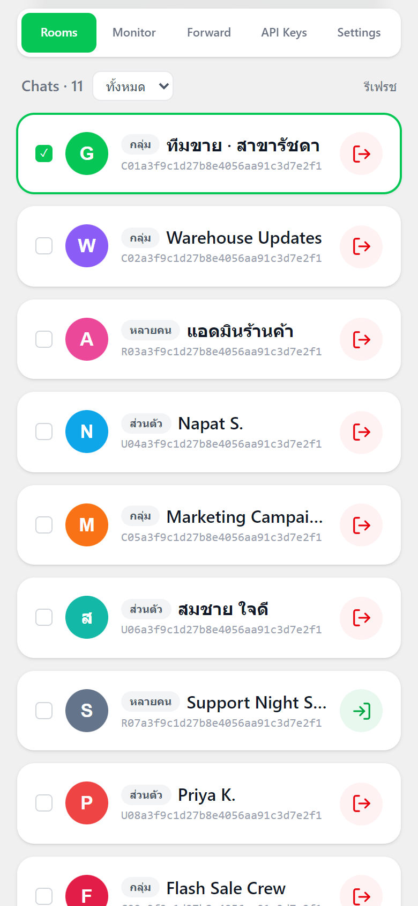
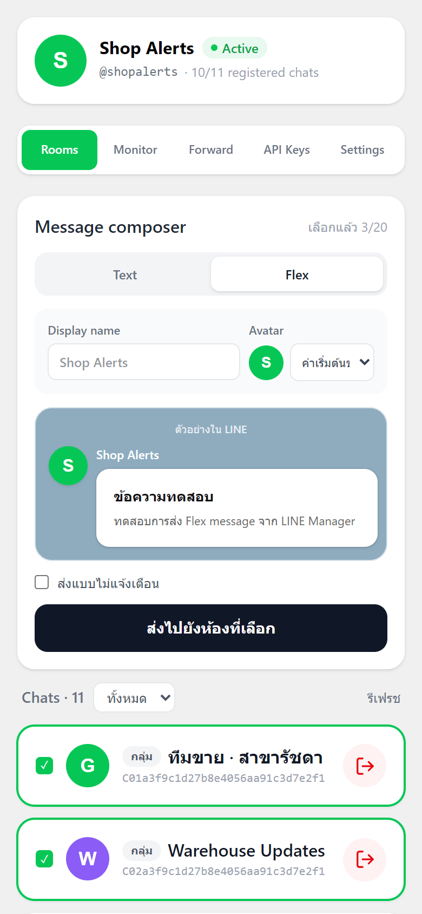
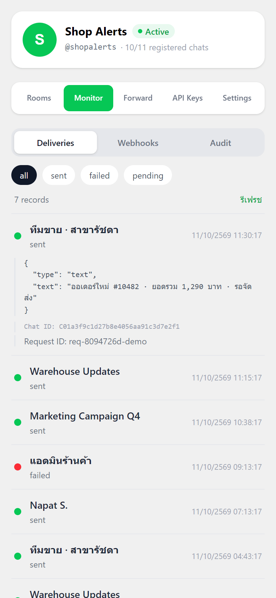
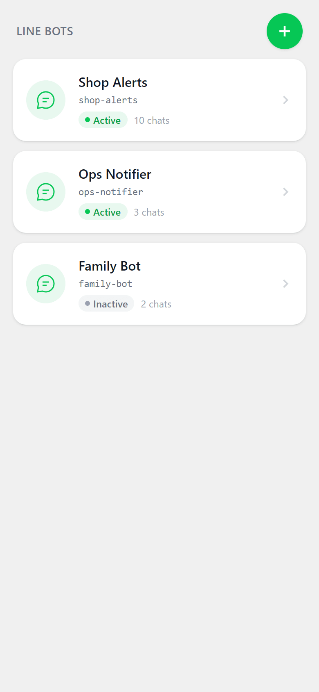
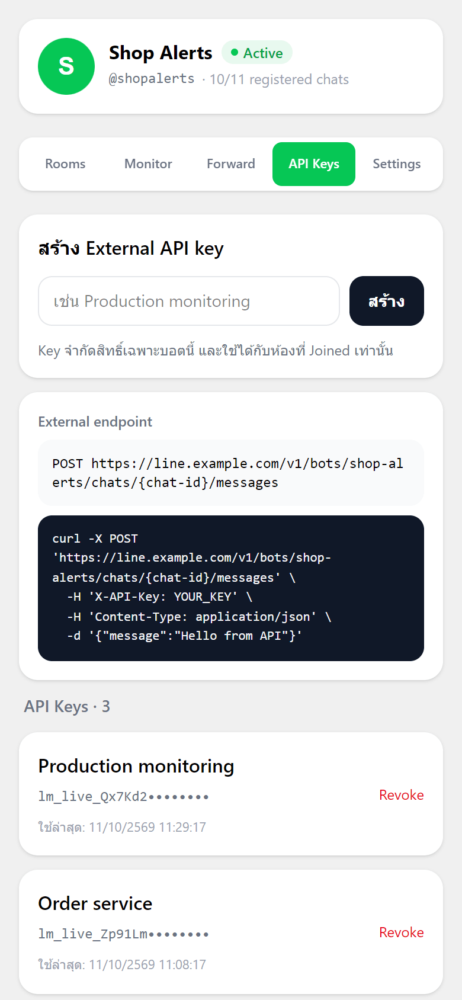
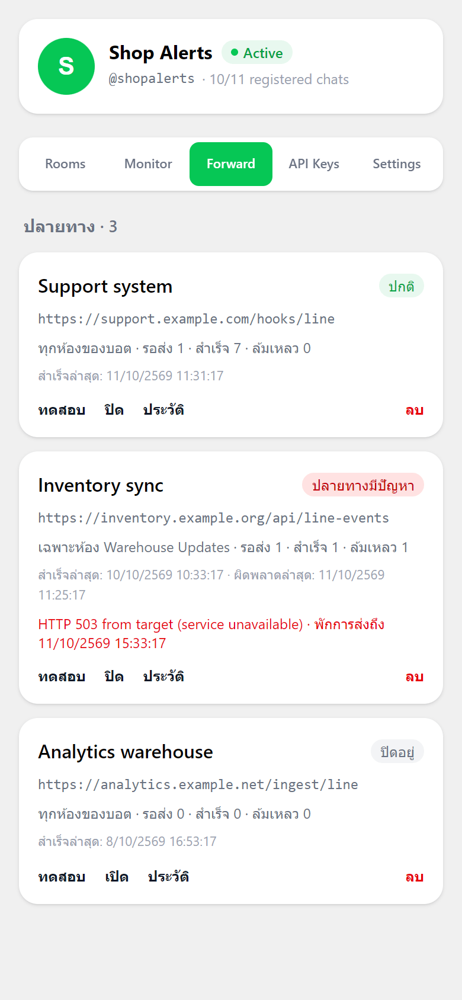
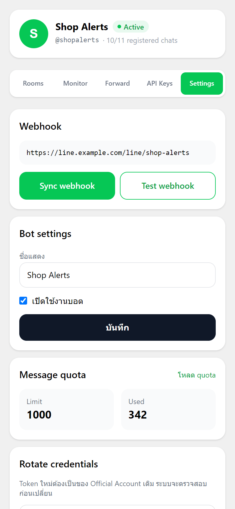

<div align="center">

# LINE Manager

**A self-hosted API wrapper for LINE. Run every bot you own from one LINE account.**

Send messages, receive webhooks and forward them anywhere, all behind one clean REST API.<br>
No SaaS, no per-message fees, no data leaving your server.

[](https://github.com/dvgamerr-app/notice-manager/stargazers)
[](https://github.com/dvgamerr-app/notice-manager/releases)
[](LICENSE)
[](https://github.com/dvgamerr-app/notice-manager/pkgs/container/notice-manager)

[Website](https://dvgamerr-app.github.io/notice-manager/) · [Quick start](#-deploy-in-5-minutes) · [Self-hosting guide](docs/self-hosting.md) · [ภาษาไทย](README.th.md)

<br>





<br>

**If this saves you time, please [⭐ star the repo](https://github.com/dvgamerr-app/notice-manager). It is the best way to help other LINE developers find it.**

</div>

---

## Why LINE Manager?

LINE's Messaging API is powerful, but running more than one bot means juggling channel
tokens, webhook URLs, user/group/room IDs and signature checks. LINE Manager puts a
self-hosted layer on top of it:

- **One LINE account, many bots.** Sign in once with LIFF and manage every Messaging API channel from your phone.
- **One simple API.** Your scripts, CI, cron jobs and servers call `POST /v1/bots/:bot/chats/:chat/messages` with an API key. They never touch a LINE token.
- **Fully self-hosted.** Your tokens are AES-256-GCM encrypted in your own database. Nothing is sent to a third party.
- **Deploys with one command.** A prebuilt multi-arch image, SQLite by default and three settings. No build step.

## Features

| | |
|---|---|
| 🤖 **Multi-bot management** | Add many Messaging API bots. Webhooks are set up and verified with LINE automatically. |
| 💬 **Automatic room discovery** | Users, groups and multi-person chats appear from signed webhooks. Send `/hi` to register a chat, `/id` to get its ID. |
| 📨 **Text and Flex sender** | Compose Text or Flex messages with a LINE-style preview and a custom sender name and avatar, then send to up to 20 rooms at once. LINE validates every payload before it is pushed. |
| 🔑 **Bot-scoped API keys** | `lm_live_...` keys are hashed at rest and shown once. Each key reaches only the registered chats of its own bot. |
| 🚦 **Distributed rate limits** | An atomic, database-backed per-key bucket works across every instance and returns standard `RateLimit-*` headers. |
| 🔀 **Webhook forwarding** | Fan LINE events out to your own HTTPS endpoints. Each target has its own signing secret, retries with backoff, a circuit breaker and a delivery history. |
| 🔍 **Monitor and audit trail** | Deliveries, webhook events and audit logs are searchable, with human-readable chat names. |
| 🛡️ **Secure by default** | HMAC webhook signature checks, idempotent redelivery, SSRF protection on forwards, encrypted credentials and a single-owner policy. |
| 🗄️ **SQLite or PostgreSQL** | Start with zero setup on SQLite and move to PostgreSQL when you need it. The same migrations run on both. |

<details>
<summary><b>More screenshots</b></summary>
<br>
<p align="center">
  
  
  
  
</p>
</details>

## 🚀 Deploy in 5 minutes

You need a server or VPS with Docker and a public HTTPS URL, which LINE requires. The
steps below create the URL for you with Caddy and Let's Encrypt.

**1. Create the LINE side** (once)

1. In the [LINE Developers Console](https://developers.line.biz/console/), create a **LINE Login** channel.
2. Add a **LIFF app** with **Endpoint URL** `https://YOUR_DOMAIN/liff/` and the scopes `openid` and `profile`.
3. Copy the **LIFF ID**, which looks like `1234567890-AbCdEfGh`.

**2. Run it**

```bash
curl -O https://raw.githubusercontent.com/dvgamerr-app/notice-manager/main/docker-compose.yml
curl -o .env https://raw.githubusercontent.com/dvgamerr-app/notice-manager/main/.env.example

# edit .env: LIFF_ID, PUBLIC_BASE_URL, DOMAIN, and CREDENTIAL_ENCRYPTION_KEY (openssl rand -hex 32)
docker compose --profile https up -d
```

That is all. Open `https://YOUR_DOMAIN/liff/` in LINE, sign in, and tap **Add bot**.
It already has an HTTPS reverse proxy and a persistent SQLite volume. Behind your own proxy or
tunnel, drop `--profile https` and point it at port `3000`. For PostgreSQL, backups and upgrades,
see the [self-hosting guide](docs/self-hosting.md).

**3. Add your first bot**

In the dashboard choose **Add bot** and paste the bot's *Channel access token* and *Channel secret*.
LINE Manager verifies the token, points the bot's webhook at `https://YOUR_DOMAIN/line/<bot>`
and starts discovering chats. Send `/hi` to the bot in any chat to register it.

## Send a message from anywhere

Create an API key in the dashboard (**API Keys**) and call it from any language:

```bash
curl -X POST 'https://YOUR_DOMAIN/v1/bots/my-bot/chats/CHAT_ID/messages' \
  -H 'X-API-Key: lm_live_REPLACE_ME' \
  -H 'Content-Type: application/json' \
  -d '{"message":"Deploy finished ✅"}'
```

Send rich cards with `{"messages":[ ...LINE message objects... ]}` (up to 5). Limits default to 60
requests per minute per key and are tunable with `EXTERNAL_API_RATE_LIMIT`.

## Architecture

```
 your scripts / CI / servers ──► /v1/...  (API key) ─┐
                                                     ▼
 LINE phone ──► LIFF dashboard ──► /api/... ─►  LINE Manager ──► LINE Messaging API
                                                     ▲   │
 LINE platform ──► /line/:bot (signed webhook) ──────┘   └──► your webhook targets
                                                     │
                                       SQLite or PostgreSQL (encrypted credentials)
```

Built with Bun, Elysia, React, Vite, Kysely and Pino. It ships as one non-root container,
and the image is published for `linux/amd64` and `linux/arm64`.

## Documentation

- [Self-hosting guide](docs/self-hosting.md): LINE setup, every environment variable, PostgreSQL, HTTPS options, upgrades, backups
- [Thai reference](docs/reference.th.md): routes, dashboard behaviour, retention and CI/CD
- [Agent and architecture notes](CLAUDE.md): invariants, security model, source map

## Develop

```bash
bun install
bun run migrate
bun dev        # terminal 1: backend on :3000
bun dev:ui     # terminal 2: Vite on :5173
bun run check  # typecheck + tests + build
```

LINE Login needs HTTPS, so use a tunnel for real LIFF logins, or set `DEV_AUTH_BYPASS=true` and
`VITE_DEV_AUTH_BYPASS=true` to explore the UI locally.

## Support the project

LINE Manager is free and MIT licensed. If it helps you:

- ⭐ **[Star the repo](https://github.com/dvgamerr-app/notice-manager)** so others can find it
- 🐛 [Open an issue](https://github.com/dvgamerr-app/notice-manager/issues) for bugs and ideas
- ☕ [Sponsor the author](https://sponsor.dvgamerr.app)

<div align="center">

[](https://star-history.com/#dvgamerr-app/notice-manager&Date)

</div>
